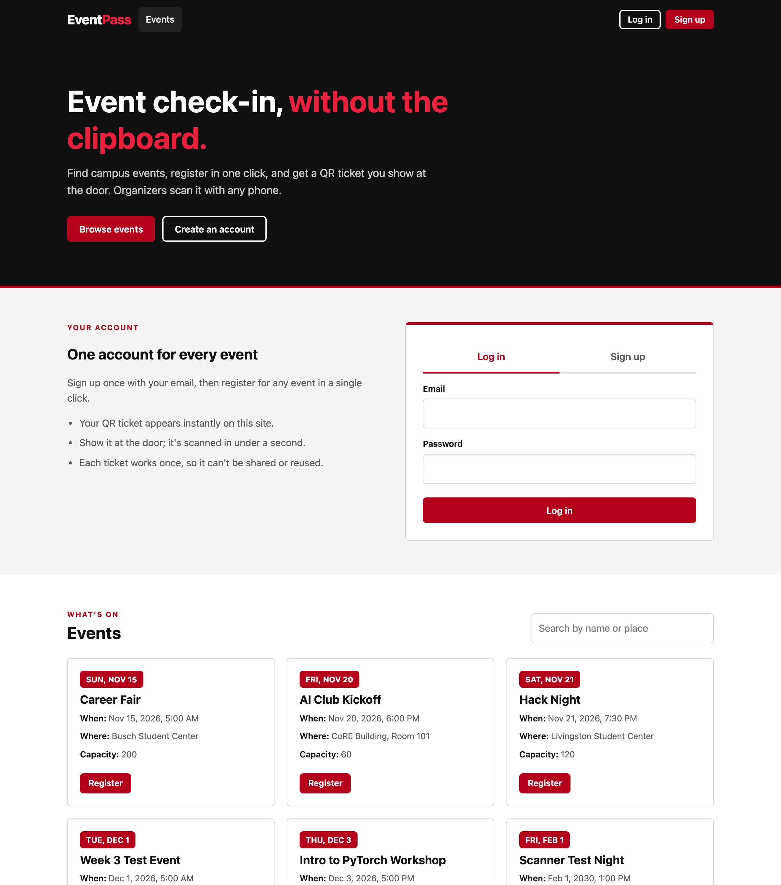
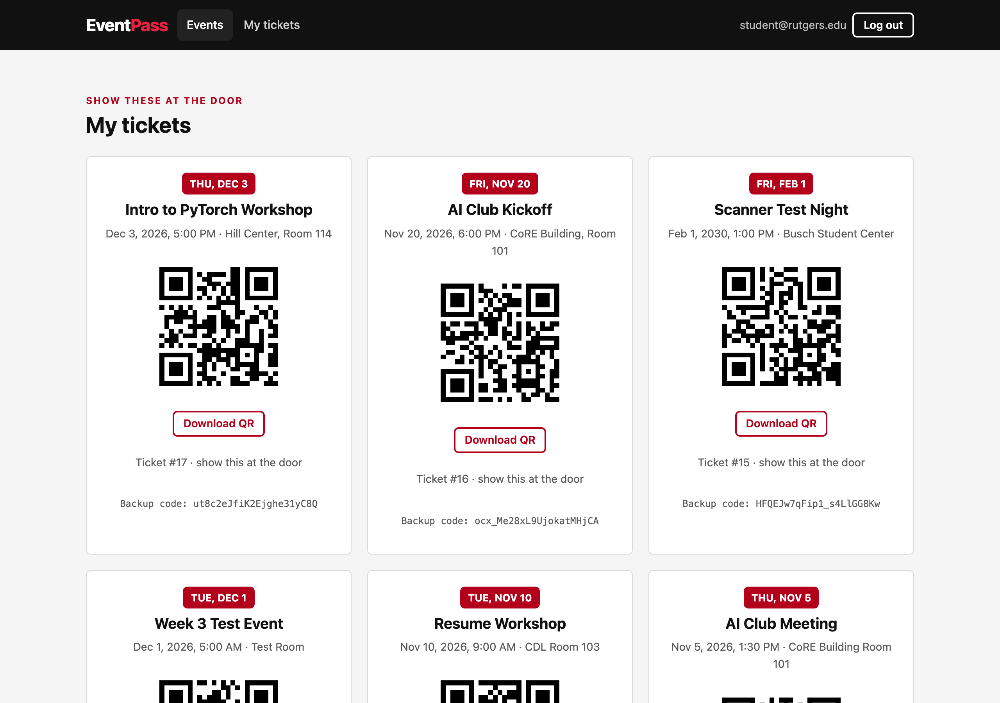
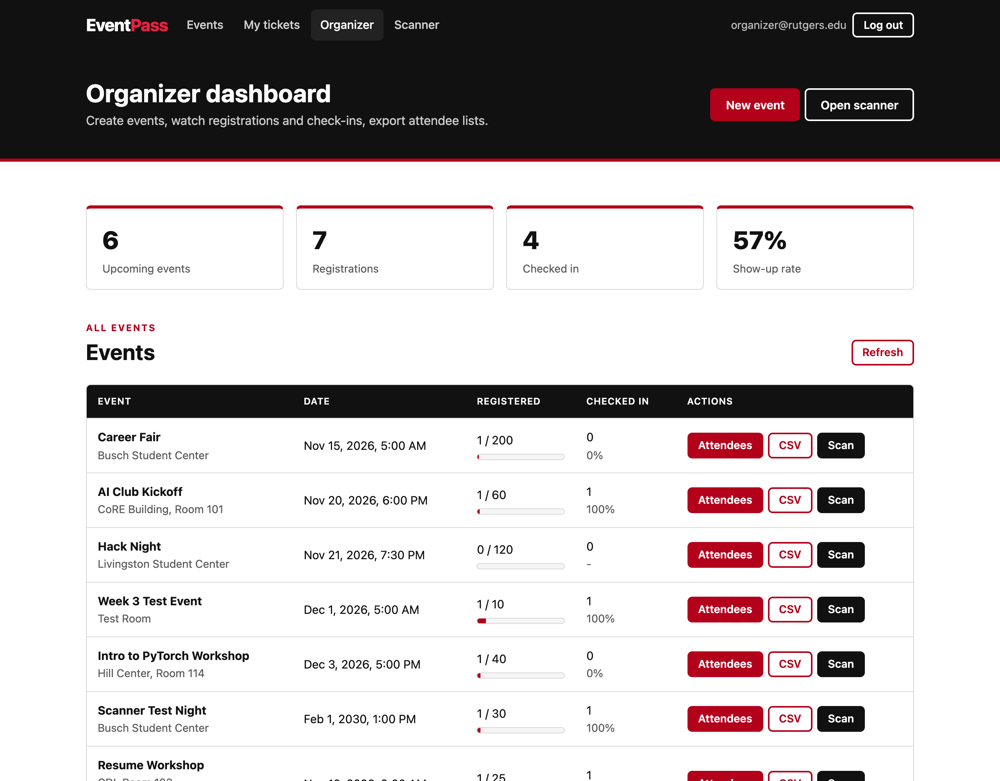
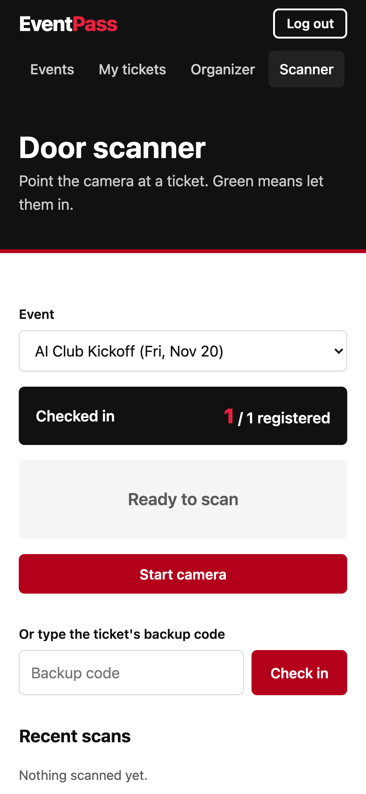
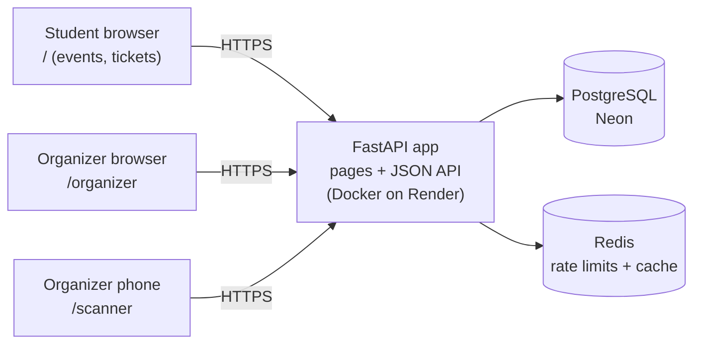

# EventPass

QR-code event check-in for student clubs. Students sign up on the website, register for events and get a QR ticket; organizers create events, watch live attendance and scan tickets at the door from a phone browser. Every ticket can be checked in exactly once — even when several organizers scan at the same moment.

**Live demo:** available on request (hosted on Render + Neon free tier; the first request after idle takes ~1 minute to wake up).

## Screenshots

| Events (public site) | My tickets |
|---|---|
|  |  |

| Organizer dashboard | Door scanner (phone) |
|---|---|
|  |  |

## Highlights

- **Race-safe check-in** — a database unique constraint (not application code) guarantees one check-in per ticket. Under load, 2,862 concurrent scans of 2,000 tickets produced **0 duplicates**.
- **Found and fixed a production-style deadlock** with load testing (details below): the API froze at 13 req/s under load; after the fix it served **~950 req/s with 0 errors** on a single worker.
- **Indexed by evidence** — `EXPLAIN ANALYZE` on a 1M-row table showed a sequential scan; one index cut the query from **16.2 ms to 0.08 ms**.
- **A complete website on the same API** — public event listing, sign-up, QR tickets, an organizer dashboard (live counts, attendee list, CSV export, manual check-in) and a phone scanner, in plain HTML/CSS/JavaScript served by FastAPI.
- **82 automated tests, 97% line coverage**, run by GitHub Actions on every pull request; `main` is protected and only accepts green PRs.

## Tech stack

| Area | Tools |
|---|---|
| API | Python 3.11, FastAPI, Pydantic |
| Data | PostgreSQL 16, SQLAlchemy 2, Alembic migrations |
| Cache / rate limits | Redis |
| Auth | JWT bearer tokens, Argon2 password hashing, student / organizer roles |
| Frontend | Plain HTML, CSS and JavaScript (no framework): public site `/`, organizer dashboard `/organizer`, phone scanner `/scanner` (camera via html5-qrcode) |
| Testing | pytest, Locust (load testing) |
| DevOps | Docker, Docker Compose, GitHub Actions, Render (app + Redis), Neon (Postgres) |

## Architecture



## How it works

1. An organizer creates an event on `/organizer`. Times are entered in the organizer's local time, sent as UTC, and stored as `timestamptz`; every visitor sees them in their own time zone.
2. A student signs up on `/`, registers with one click, and gets a ticket with a random, unguessable QR token under **My tickets** (a ticket email is also prepared in the background).
3. At the door, an organizer opens `/scanner` on a phone, picks the event, and points the camera at the student's QR code.
4. The API inserts a check-in row. **201** = welcome in, **409** = this ticket was already used, **404** = not a ticket for this event.
5. The dashboard shows live registered / checked-in counts, the attendee list, and a CSV export.

## Performance (measured)

All numbers come from Locust load tests in this repo (`loadtest/`), run locally on a MacBook (Postgres 16 and Redis in Docker; Locust on the same machine), against a database seeded with 10,000 students.

**Baseline — realistic pacing (users pause 1–3 s between actions):**

| Simulated users | Requests | Errors | Req/s | Check-in p50 | Check-in p95 |
|---|---|---|---|---|---|
| 50 | 1,957 | 0 | 33 | 13 ms | 19 ms |
| 100 | 3,731 | 0 | 63 | 10 ms | 17 ms |
| 200 | 7,462 | 0 | 126 | 8 ms | 49 ms |

**Stress — no pauses, 100 users, steady state:**

| Setup | Max DB connections | Errors | Req/s |
|---|---|---|---|
| Before the deadlock fix (1 worker) | 15 | 10% | 13 (frozen) |
| After the fix, 1 worker | 15 | 0 | ~950 |
| After the fix, 2 workers | 30 | 0 | ~1,500 |
| After the fix, 4 workers | 60 | 0 | ~1,940 |
| After the fix, 4 workers, small pool | 20 | 0 | ~1,810 |

**Index on `registrations.user_id` (1,000,000 rows):** query 16.2 ms → 0.08 ms; `GET /me/registrations` median 25 ms → 8 ms under load.

## Engineering notes

### The deadlock load testing found
With no pauses between requests, the API handled ~800 req/s for four seconds and then completed **zero** requests for 30 seconds, followed by a burst of `500` errors. The 30 seconds matched SQLAlchemy's pool timeout.

Cause: FastAPI runs regular (`def`) endpoints on a pool of ~40 threads, but the database pool had 15 connections. A request takes a connection in one thread hop (`get_current_user`) and needs *another* thread hop to finish. Under load, all 40 threads were waiting for connections while all 15 connections were held by requests waiting for a thread — a deadlock, broken only by the timeout.

Confirmed by experiment (a pool larger than the thread count made the freeze disappear), then fixed properly: an `asyncio.Semaphore` middleware admits only as many requests as there are connections. This keeps pools small, which matters because Postgres has a connection limit and every worker process has its own pool. The tuning result: 4 workers × 5 connections kept 93% of the throughput of 4 × 15 — the bottleneck is CPU, not the database.

### Design decisions

| Decision | Why | Trade-off |
|---|---|---|
| Unique constraint enforces one check-in per ticket | The database is the only place that sees every concurrent request | Duplicate scans surface as a caught `IntegrityError` → 409 |
| Capacity enforced under a row lock (`SELECT ... FOR UPDATE` on the event) | "Count, then insert" lets two people take the last seat at the same moment; the lock makes registrations for one event take turns | Registrations for the same event wait briefly for each other; a counter column with a conditional `UPDATE` would avoid waiting but needs a migration |
| Sign-up always creates a student; organizers are promoted separately | Clients must never choose their own privileges | Needs an admin step (SQL for now) |
| Redis fixed-window rate limits on login (per email + per IP) and sign-up | Stops password guessing before the slow Argon2 check runs | Fixed windows allow short bursts at window edges |
| Client IP from `CF-Connecting-IP` | Render sits behind Cloudflare, which overwrites this header; `X-Forwarded-For` can be spoofed | Tied to the hosting setup |
| Rate limiting and caching **fail open** | If Redis is down, the app gets slower, not broken | No rate limiting during a Redis outage |
| Cache event reads (60 s TTL) with versioned keys for pagination | Creating an event bumps a version number instead of hunting down every cached page | A list can be up to 60 s stale if Redis drops an invalidation |
| Background tasks for ticket emails | The student gets a response immediately | A task is lost if the server restarts at that moment (no retry queue); no email provider is connected yet, so emails are only logged |
| `limit`/`offset` pagination (max 100) | Simple and enough at this size | Large offsets get slower; keyset pagination would scale better |
| `pool_pre_ping=True` | Neon closes idle connections; this checks a connection before using it | One tiny extra query per checkout |
| All times are `timestamptz`; the API rejects times without a zone (422) and answers in UTC | A time without a zone is ambiguous once users are in different places | A breaking API change (clients must send a zone) |
| FastAPI serves the website itself (plain HTML/JS, no framework) | Same origin: no CORS, one deploy, nothing to build | No component reuse or client-side routing; fine at this size |
| Token kept in `sessionStorage` | Cleared when the tab closes (safer on shared lab computers than `localStorage`) | Readable by JavaScript; an `httpOnly` cookie would be safer but needs CSRF protection |
| Page data is inserted with `textContent`, never `innerHTML` | User-supplied text (event names) can't run as script (XSS) | Building elements in code is more verbose than HTML strings |
| QR codes and CSVs are fetched with `fetch` and shown as blobs | These endpoints need the bearer token, which a plain `` link can't send | Slightly more JavaScript |

## Running locally

**With Docker Compose** (app + Postgres + Redis):

```bash
cp .env.example .env
# set SECRET_KEY in .env, e.g. python -c "import secrets; print(secrets.token_urlsafe(32))"
docker compose up --build
```

Open <http://localhost:8000> for the website (sign up there), <http://localhost:8000/organizer> for the organizer dashboard, and <http://localhost:8000/docs> for the interactive API. New accounts are students; to make one an organizer:

```bash
docker compose exec db psql -U eventpass -d eventpass -c "UPDATE users SET role = 'organizer' WHERE email = 'you@example.com';"
```

**Running the tests** (needs Postgres on port 5432 with an `eventpass_test` database, and Redis on 6379 — see `.env.example`):

```bash
python -m venv .venv && source .venv/bin/activate
pip install -r requirements.txt
python -m pytest -q
```

**Load testing:** `pip install -r requirements-loadtest.txt`, seed a separate `eventpass_load` database with `python -m loadtest.seed`, then run `locust -f loadtest/locustfile.py`. `loadtest/bulk_registrations.sql` grows the data to 1M registrations for index experiments.

## API

| Method | Path | Who | Purpose |
|---|---|---|---|
| POST | `/auth/signup` | anyone | Create a student account (rate limited) |
| POST | `/auth/login` | anyone | Get a JWT (rate limited) |
| GET | `/auth/me` | logged in | Current user |
| GET | `/events` | anyone | List events (`limit`, `offset`; cached) |
| POST | `/events` | organizer | Create an event |
| GET | `/events/{id}` | anyone | One event (cached) |
| POST | `/events/{id}/registrations` | student | Register and get a QR ticket (409 if already registered or full) |
| GET | `/events/{id}/registrations` | organizer | Registrations for an event (paginated) |
| GET | `/me/registrations` | logged in | My tickets |
| GET | `/me/registrations/{id}/qr` | ticket owner | Ticket QR code as PNG |
| POST | `/events/{id}/check-ins` | organizer | Check in a ticket (201 / 409 / 404) |
| GET | `/events/{id}/attendance` | organizer | Capacity, registered, checked-in counts |
| GET | `/events/{id}/attendees.csv` | organizer | CSV export |
| GET | `/health` | anyone | Liveness + database check (503 if the DB is down) |

**Web pages** (served by the same app; the pages themselves are public, the data behind them needs a login):

| Path | Page |
|---|---|
| `/` | Public site: events, log in / sign up, register, my QR tickets |
| `/organizer` | Organizer dashboard: create events, live counts, attendees, CSV, manual check-in |
| `/scanner` | Phone scanner for the door |
| `/static/*` | Shared CSS and JavaScript |

## Deployment

Pushing to `main` (only possible through a pull request with passing CI) triggers Render to build the Docker image and deploy after the checks pass. The container runs `alembic upgrade head` before starting, so schema changes ship with the code.

## Limitations and next steps

- Prove the capacity lock under real concurrency (e.g. 50 Locust users racing for 10 seats should give exactly 10)
- The dashboard asks for each event's counts separately; a single summary endpoint would scale better
- Organizer promotion is a SQL step; an admin page would replace it
- Connect an email provider (required for ticket emails and password reset)
- Password reset
- Use it at a real club meeting and report real-world numbers